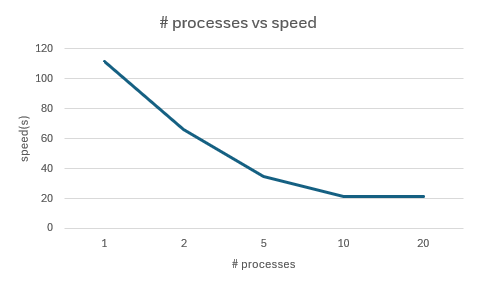
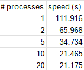
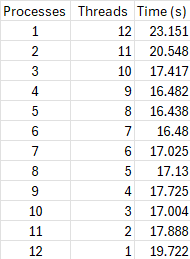

# lab12_multithreading_mandelbrot
#### This project is a demonstration of multiprocessing and multithreading in image generation.
Program creates 50 mandelbrot images and processes them with a number of processors determined by the input. Task is completed using `fork()`.
Each image is also calculated individually with `pthread`.

To run (terminal):
1. `make`
2. `./mandelmovie -p <# processors> -t <# threads>`
note: the default is 20 cores and 1 thread.

The image output will be located in the folder `images`.

As shown by the graph, there is an inverse logarithmic relationship between the number of processors used and the time it takes to complete 50 mandelbrot calculations.

### Multithreading

This program has pthread implemented into `mandel.c` which enables each image to be generated by the power of multiple cores.

* for extreme differences in processors versus threads, multiprocessing had a greater effect. But for fine-tuning where the number of threads and processes were similar the threads made a bigger difference.

I think this is because for the extreme cases there is greater overhead per image which outweighs the time loss from more complex image processing. This makes it more viable to have multiple images processing at the same time as processes target overhead better.
For the fine-tuned case, the complex images take up more time to process than the overhead. So multithreading in this case is more impactful as it handles the issue with a greater time drain which is the complex images.

* The sweet spot was 8 threads and 5 processes with a runtime of 16.438 seconds.